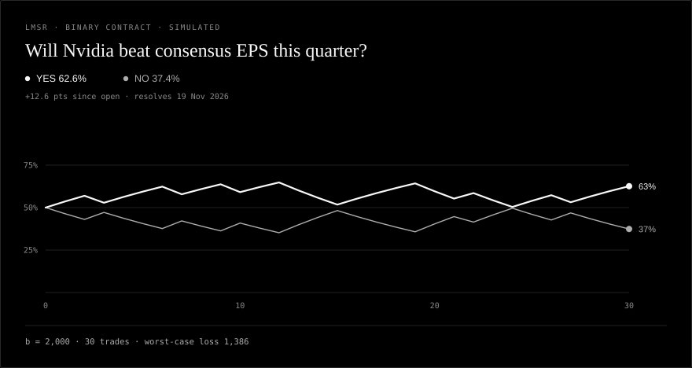

# lmsr

[](https://github.com/Jdave211/lmsr/actions/workflows/ci.yml)

A self-contained market maker for the Logarithmic Market Scoring Rule.

Exact prices, a bounded worst case, and 57 tests that assert equalities instead
of tolerances. Standard library only, Python 3.9+.

A prediction market needs a counterparty that will quote any outcome at any
time and cannot be picked off. LMSR supplies one with a single convex cost
function over one state vector. This repository is that function and the layer
around it: quoting, bundles, NO contracts, fees. No order book, no matching
engine, no database, no product code.

---

## What it guarantees

| Property | Statement | Test |
|---|---|---|
| Prices sum to one | `p_i = exp(q_i/b) / Σ exp(q_j/b)` | `test_prices_sum_to_one` |
| The prior is the price | opening at `p` is exact to 1e-12 | `test_seed_is_exactly_the_inverse` |
| Path independence | any route to `q` costs `C(q') - C(q)` | `test_one_trade_equals_ten` |
| Bounded loss | max loss `= -b·ln(min p0)` | `test_informed_prior_raises_the_bound` |
| No overflow | `q/b = 10^6` stays finite | `test_huge_quantities_do_not_overflow` |
| NO is a bundle | NO trades at exactly `1 - p_i` | `test_binary_no_is_the_other_outcome` |
| Sells are exact | closed form, no bisection | `test_shares_for_refund_inverts_sell_refund` |

The tests are the specification. If a property is not in that table, it is not
claimed.

---

## The one idea

Everything is a scalar potential over a single state vector: `q`, the
outstanding shares of each outcome.

```
C(q) = b * ln( sum_i exp(q_i / b) )
p_i  = exp(q_i / b) / sum_j exp(q_j / b)
```

The cost of a trade is `C(q_end) - C(q_start)`. Cost depends on where you end
up, never on the route. That is not a nicety; it is why every invariant above
is a consequence of one function rather than a promise made in six places.

`b` is **depth**. It is chosen when the market opens and never changes. It is
not a budget.

## Two contract types

Binary and multi-outcome markets use the same cost function; only the state
vector changes. Both are engine output, not mock-ups.



*Binary: one event, two complementary prices, one depth, one worst case.*


*Multi-outcome: six labs, one distribution. The bands sum to 1 at every point in
time, because the prices always do.*

Live demo: [jdave211.github.io/lmsr](https://jdave211.github.io/lmsr/).

---

## Quickstart

```python
from lmsr import Market

m = Market(["beats", "misses"], b=2_000, probabilities=[0.62, 0.38])

m.prices          # (0.62, 0.38) -- exactly what you asked for
m.max_loss        # 1,936 -- b * -ln(0.38), not b
m.buy("beats", 120)             # shares
m.buy_for_cash("beats", 50.0)   # cash, fee included
m.buy_no("beats", 40)           # 40 NO contracts, each pays 1
m.worst_case_loss              # <= m.max_loss, always
```

Open at prices you choose:

```python
q = lmsr.seed_quantities([0.25, 0.25, 0.5], b=2_000)
# q_i = b * ln(p_i): the exact inverse of the price map
```

Choose depth from the risk you will accept:

```python
b = lmsr.b_for_loss(max_loss_amount=10_000, n_outcomes=4)  # 7,213
```

Both cash quotes are closed form:

```
buy  delta shares for cash c:  delta = b * ln(1 + (e^{c/b} - 1) / p_i)
sell delta shares for cash c:  delta = -b * ln(1 - (1 - e^{-c/b}) / p_i)
```

---

## The loss bound

The figure usually quoted is `b * ln(n)`. That is one case of the general
bound:

```
max loss = -b * ln( min_i p0_i )
```

Derivation. If outcome `k` wins, the maker's loss is

```
(q_k - q0_k) - (C(q) - C(q0))
```

and `C(q) >= q_k` for every `q`, so the first term is at most zero. The loss is
therefore at most `C(q0) - q0_k = -b * ln(p0_k)`. Take the worst `k`.

Two consequences:

1. **An informed prior is a position.** Opening a 0.1% longshot at
   `b = 20,000` risks 138,000, not the 13,900 that `b * ln(2)` suggests.
2. **The bound covers every trade sequence, bundles included**, because a
   bundle is a step in `q`. No trade type escapes it.

That is why NO is a bundle rather than separate arithmetic: the bound is a
property of the state, so it holds only if every trade is a state update.

---

## Does depth buy accuracy?

`python examples/depth_study.py` simulates traders with noisy beliefs and
scores the resulting prices with a proper rule (Brier). Depth has an optimum,
and it is not "as deep as possible".


Binary market, truth 80/20, opening at 50/50, 30 traders spending 150 each,
400 replications per point:

| b | max loss | expected Brier | loss used |
|---:|---:|---:|---:|
| 100 | 69 | 0.644 | 74% |
| 2,000 | 1,386 | **0.341** | 50% |
| 50,000 | 34,657 | 0.458 | 10% |

Too shallow amplifies belief noise; too deep buys underreaction. The minimum
sits where price impact matches the information the traders actually have.

A second result, in [`examples/depth_results.md`](examples/depth_results.md):
scale trader budgets with the maker's capacity and accuracy is roughly *flat*
in depth from `b = 100` to `b = 50,000`, while the loss bound rises 500×. Depth
is the price of a given amount of information, not a quality setting.

---

## Context

The same mechanism runs in [probable.fun](https://github.com/Jdave211/probable.fun),
a private-group prediction market, where it prices real trades. This repository
is the standalone implementation: the cost function, the quoting layer, and the
tests, with the product layer removed.

**Research context.** The method comes from **tenr**, a research kit for honest
empirical work: ask a falsifiable question, score it with a proper rule, count
the trials, and report the cost next to the result. The depth study above is
that method applied to a mechanism question.

---

## Layout

```
lmsr/
  core.py       cost function, prices, quotes, loss bound
  market.py     stateful market: buy, sell, bundles, NO, fees, history
  scoring.py    Brier, log loss, calibration
  simulate.py   noisy traders, for the study
tests/          57 tests, most of them exact properties
examples/       depth study, chart generator, generated results
assets/         the three SVGs used above
docs/           design notes, plus the static market page (index.html)
```

## Tests

```bash
python -m unittest discover -s tests -v
python examples/depth_study.py
```

## Contributing

See [CONTRIBUTING.md](CONTRIBUTING.md). The short version: the state is a vector
`q`, every operation is `C(q') - C(q)`, the package stays standard-library
only, and a change to the engine needs a test that fails on the old behaviour.

Security reports go through [private advisories](https://github.com/Jdave211/lmsr/security/advisories/new),
not public issues. The project follows the [Contributor Covenant](CODE_OF_CONDUCT.md).

## License

MIT. See [LICENSE](LICENSE). Contributions are accepted under the same terms.
