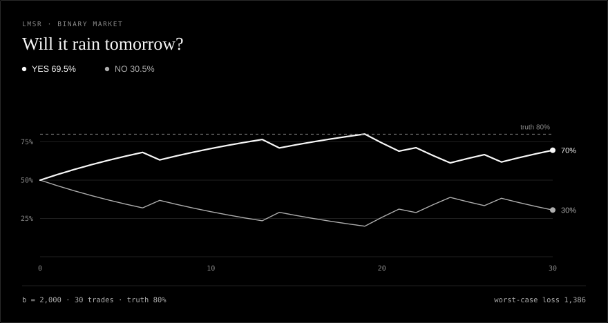
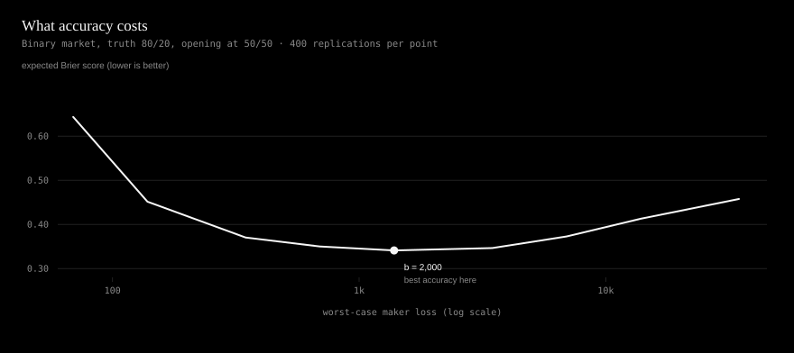

# lmsr

A numerically honest LMSR market maker. Fixed depth, exact prices, and a loss
bound you can prove in one line.

The engine behind [probable.fun](https://github.com/Jdave211/probable.fun), a
private-group prediction market, separated from the product around it. Same
mechanism; no framework, no database, no hidden transforms. Stdlib only, 57
tests, Python 3.9+.

---

## The one idea

Everything is a scalar potential over a single state vector: `q`, the
outstanding shares of each outcome.

```
C(q) = b * ln( sum_i exp(q_i / b) )
p_i  = exp(q_i / b) / sum_j exp(q_j / b)
```

The cost of a trade is `C(q_end) - C(q_start)`. So cost depends on where you
end up and never on the route. That is not a nice-to-have; it is why the engine
can be tested with exact equalities instead of tolerances, and why every
classical invariant is a consequence rather than a promise:

- prices sum to 1,
- `C` is convex,
- buying in ten pieces costs the same as buying in one,
- the maker's worst case has a closed form.

`b` is **depth**. It is chosen once, when the market opens, and never changes.
It is not a budget.



*A binary market, opened at 50/50, after thirty simulated participants. The two
lines are one event and its complement. The maker's worst case is printed on the
card, because a probability without its risk is a sales pitch. Live demo:
[jdave211.github.io/probable-lmsr](https://jdave211.github.io/probable-lmsr/).*

---

## Quickstart

```python
from lmsr import Market

m = Market(["rain", "no rain"], b=500.0, probabilities=[0.3, 0.7])

m.prices          # (0.3, 0.7) -- exactly what you asked for
m.max_loss        # 601.99 -- b * -ln(0.3), not b
m.buy("rain", 120)             # shares
m.buy_for_cash("rain", 50.0)   # cash, fee included
m.buy_no("rain", 40)           # NO is a bundle, each contract pays 1
m.worst_case_loss              # <= m.max_loss, always
```

Open at prices you choose:

```python
q = lmsr.seed_quantities([0.25, 0.25, 0.5], b=2_000)
# q_i = b * ln(p_i): the exact inverse of the price map
```

Pick a depth from the risk you will accept, not the other way round:

```python
b = lmsr.b_for_loss(max_loss_amount=10_000, n_outcomes=4)  # ~7,213
```

---

## The loss bound

The figure normally quoted is `b * ln(n)`. That is the special case of a market
opening at equal prices. The general bound is:

```
max loss = -b * ln( min_i p0_i )
```

Derivation. If outcome `k` wins, the maker's loss is

```
(q_k - q0_k) - (C(q) - C(q0))
```

and since `C(q) >= q_k` for every `q`, the first term is at most zero. So the
loss is at most `C(q0) - q0_k = -b * ln(p0_k)`. Take the worst `k`.

Two consequences that matter in practice:

1. **Seeding an informed prior is a position.** Opening a 0.1% longshot at
   `b = 20,000` risks ~138,000, not the ~13,900 that `b * ln(2)` suggests.
2. **The bound holds for every trade sequence, bundles included**, because a
   bundle is just a step in `q`. There is no trade type that escapes it.

That is why "NO" is implemented as a bundle rather than with separate
arithmetic: the bound is a property of the state, so it survives only if every
trade is a state update.

---

## What changed when the engine left the product

`probable.fun` is a live product, and every choice below was reasonable inside
it. They stop being reasonable when the same mechanism has to be read, tested
and reused, so moving the engine out meant deciding them again. None of this is
a claim that the product was wrong; it is a record of what a library needs that
a product can absorb.

| # | In the product | As a library |
|---|---|---|
| 1 | `b` was floored at a per-market default, so a creator could raise depth but not lower it | `b` is required; no default, no floor |
| 2 | The field surfaced as "liquidity" was `b`, which is not the amount at risk | `max_loss` is `-b·ln(min p)`; `b_for_loss` inverts it |
| 3 | `math.exp(q/b)` could overflow past ~709, and longshots could underflow to 0 | log-sum-exp throughout; exact log-prices |
| 4 | Opening probabilities were floored and softened toward equal before trading | the prior is the price, to 1e-12; softening is opt-in |
| 5 | "Buy NO" used complement arithmetic built outside the cost function | NO is the bundle of every other outcome, priced at `1 - p_i` |
| 6 | Sells used a 60-step bisection, with no path-independence test | closed forms, plus tests asserting one trade == ten |

Full write-up with the reasoning and the test that pins each one:
[`docs/design.md`](docs/design.md).

---

## Does depth buy accuracy?

Run `python examples/depth_study.py`. It simulates traders with noisy beliefs
and scores the final prices with a proper rule (Brier). The short answer is
that depth has an optimum, and it is not "as deep as possible".



Binary market, truth 80/20, opening at 50/50, 30 traders spending 150 each:

| b | max loss | expected Brier | loss used |
|---:|---:|---:|---:|
| 100 | 69 | 0.644 | 74% |
| 2,000 | 1,386 | **0.341** | 50% |
| 50,000 | 34,657 | 0.458 | 10% |

Too shallow amplifies belief noise; too deep buys underreaction. The minimum is
where price impact matches the information the traders actually have.

A second result, in [`examples/depth_results.md`](examples/depth_results.md):
scale the traders' budgets with the maker's capacity and accuracy becomes
roughly *flat* in depth from `b = 100` to `b = 50,000`, while the loss bound
rises 500×. Depth is the price of a given amount of information, not a quality
setting.

---

## Layout

```
lmsr/
  core.py       cost function, prices, quotes, loss bound
  market.py     stateful market: buy, sell, bundles, NO, fees, history
  scoring.py    Brier, log loss, calibration
  simulate.py   noisy traders, for the study
tests/          57 exact-property tests
examples/       depth study, chart generator, generated results
assets/         the two SVGs used above
docs/           design notes, plus the static market page (index.html)
docs/design.md  the six changes, with the test that pins each
```

## Charts

The two figures are standalone SVG generated with the standard library, in the
palette and type of the tenr landing page. No plotting dependency, no external
font, no CDN.

```bash
python examples/make_charts.py        # rewrites assets/*.svg and demo/market.html
```

## Tests

```bash
python -m unittest discover -s tests -v
python examples/depth_study.py
```

The tests are the specification. They assert exact properties (prices sum to
one, a trade costs the same in ten pieces as in one, worst-case loss never
exceeds the bound), not approximate behaviour.

## Provenance

Extracted from [probable.fun](https://github.com/Jdave211/probable.fun) (MIT),
where the engine runs inside a full product. This is the pricing mechanism
alone: no product code, no database, no API.

## License

MIT. See [LICENSE](LICENSE).
